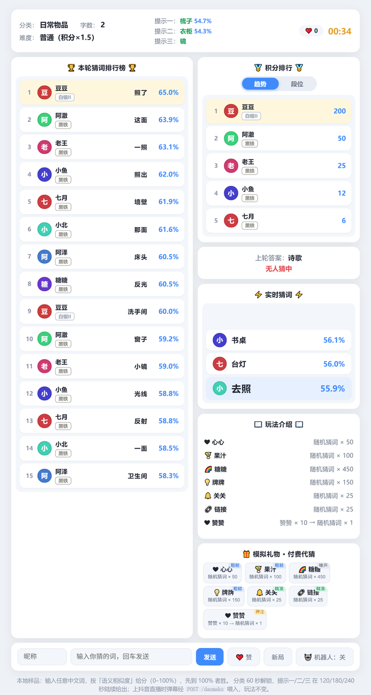

<div align=center>

# 猜词游戏 · 中文语义猜词


<p>一个本地就能玩的中文语义猜词游戏：输入任意词，返回它和谜底的语义相似度（0–100），先摸到 100% 的赢。<br>
复刻抖音直播间「猜词」玩法的完整机制：300 秒一局、三档情报、排行榜去重、名次奖与段位、机器人陪玩、礼物代猜。</p>



</div>

## 这是什么

不是「猜数字」也不是「接龙」——谜底是一个词，你输入的词和它的**词向量余弦相似度**就是你的分数。
谜底是「莲子」时，答「莲蓬」66.1 分、「荷花」55.7 分、「玫瑰」45.9 分、「苹果」37.3 分，靠语义远近一步步逼近，比纯瞎猜有意思得多。

游戏逻辑全部在本地跑，**不联网、不需要任何大模型 API**：一个 143,613 词的中文词向量表（51 MB，随仓库自带）+ numpy 就够了。

## 三十秒跑起来

```bash
git clone https://github.com/LzyJay/semantic-guess-game.git
cd semantic-guess-game
pip install -r requirements.txt
python server.py
```

浏览器打开 **http://127.0.0.1:8791** ，填个昵称就能玩。

- Windows 也可以直接双击 `start.bat`（用 waitress 起服务）
- macOS / Linux：`./start.sh`

需要 Python 3.10+；除 `flask` / `numpy` / `waitress` 外没有其他依赖。

## 玩法机制

| 模块 | 规则 |
|---|---|
| 一局 | 300 秒；难度 简单 ×1 / 普通 ×1.5 / 困难 ×2 |
| 打分 | 词向量 cosine × 100，保留一位小数；猜中谜底本身 = 100.0 |
| 词表外（OOV） | 不拒绝输入：按「字符向量平均」估算，**封顶 12 分**并标 `≈`，避免误导 |
| 排行榜 | 按分数降序；**同一玩家 + 同一个词**只占一行，同词不同玩家各占一行 |
| 奖励 | 猜中者拿第 1 名奖励 200 × 倍率；无人猜中则按名次发 200 / 50 / 25 / 12 / 6 × 倍率 |
| 情报一 | 60 秒：解锁分类 |
| 情报二 | 120 秒：给一个提示词，它与谜底的相似度**落在 60–70 分段** |
| 情报三 | 180 秒：再给一个提示词，相似度**落在 70–80 分段** |
| 情报四 | 240 秒：揭晓谜底的**第一个字** |
| 提示词防剧透 | 提示词不含谜底首字（首字留给最后一档）；优先「最佳上位词」，如 铅笔 → 文具 |
| 点赞门槛 | 原版是「时间 + 赞数」双条件；`--require-likes` 开启即还原（默认只看时间，方便本地体验） |
| 段位 | 每人独立的段位 + 档内进度，积分溢出结转晋升（青铜I 73/100 +200 → 白银II 173/200） |

## 功能

- [x] 语义相似度打分引擎（纯 numpy 解析 word2vec，不依赖 gensim）
- [x] 三档情报 + 分类，按时间（可叠加点赞数）解锁
- [x] 排行榜 `(玩家, 词)` 组合去重、`bisect` 增量插入（名次 = 插入位置，无全量排序）
- [x] 名次奖励、猜中结算、段位进度与晋升
- [x] 实时弹幕流：单调 `seq` + 环形缓冲，前端 500 ms 增量拉取，最新三条分级高亮
- [x] 机器人陪玩：5 秒一个词，绝大多数时候是普通玩家，偶发「灵光一闪」从高分区捞词
- [x] 礼物代猜（演示）：按礼物档位决定代猜词的参考度，后台逐条发射、可随时掐断
- [x] 抖音弹幕接口预留：`/danmaku`、`/danmaku/batch`
- [x] 压测脚本 + `/health` 自报内存，见 [docs/压测报告.md](docs/压测报告.md)

## HTTP 接口

| 方法 | 路径 | 说明 |
|---|---|---|
| GET | `/` | 游戏面板 |
| GET | `/state?viewer=昵称` | 局状态、榜单、情报、我的成绩 |
| GET | `/feed?since=N` | 弹幕增量流（`N` = 上次拿到的 `seq`） |
| POST | `/guess` | `{player, word}` 猜词 |
| POST | `/danmaku` | 同上，给直播弹幕桥用的单条入口 |
| POST | `/danmaku/batch` | `{items: [[player, word], ...]}` 批量（上限 2000/批） |
| POST | `/like` | 点赞 +1 |
| POST | `/newround` | 强开新局 `{n_chars?, difficulty?}` |
| POST | `/bot` | `{on, mode, name, sharp, win}` 开关机器人、实时调概率 |
| GET | `/answer` | 主持人视图（仅 127.0.0.1，显示当前谜底） |
| GET | `/gifts` `POST /gift` `POST /gift/sim` | 礼物目录 / 订单裁决 / 演示代刷 |
| GET | `/health` | 健康检查 + 服务端 RSS、线程数、榜长 |

## 词向量

仓库里的 `vectors.npz` 是 **143,613 词 × 200 维 float16**（51 MB），来自
[腾讯 AI Lab 中文词向量](https://ai.tencent.com/ailab/nlp/en/embedding.html) 的轻量版子集，
按 **CC BY 3.0** 许可在此署名分发（代码本身是 MIT）。float16 存储只影响体积，实测相似度与 float32 **完全一致到 0.1 分**。

想换更大的词表（比如 200 万词的 d100-Small）：

```bash
python tools/build_vectors.py --model path/to/light_tencent.bin            # 14 万词，200 维
python tools/build_vectors.py --model path/to/Tencent_AILab_ChineseEmbedding.txt --limit 500000
python tools/build_vectors.py --help                                        # 参数说明
```

生成的 `big_vectors.npz` 会被引擎优先加载（它已在 `.gitignore` 里，不要提交）。加载顺序：
`$GUESS_NPZ` → `big_vectors.npz` → `vectors.npz` → 原始模型文件（`light_tencent.bin` / `*.txt`，自动生成缓存）。

> 内存提醒：200 万词 × 100 维 float32 约占 800 MB，加载后归一化副本再加 800 MB。14 万词只有约 110 MB。

## 接抖音直播

弹幕通路已经留好了，直播侧把弹幕转成一次 HTTP 请求即可：

1. **投喂弹幕**：`POST /danmaku {player, word}`，与网页里手动猜词走完全相同的逻辑。
   机器人就是这条通路的活演示（`POST /bot {"on":true}`）。
2. **取弹幕的两条路**：借已登录的浏览器抓聊天区文本 → 正则「昵称 ： 词」→ 轮询投喂（3–5 秒）；
   或走抖音开放平台直播弹幕 WebSocket（需授权，更实时）。
3. **点赞数**：把直播间点赞数定时写进 `POST /like`，情报的「时间 + 赞」双条件就与原版一致（启动加 `--require-likes`）。
4. **礼物代猜**：`POST /gift/sim {gift_key, sender, count}` 会按档位在后台逐条发词，
   450 词的礼物是噪声、25 词的是精准押注——这是原版「花钱买发言次数」的商业逻辑。

> 自动读取直播间、自动发弹幕都属于对外交互，上线前请自行确认平台规则。

## 性能

`python server.py --serve waitress --threads 32` 单机实测（Windows 10 / Python 3.13）：

| 场景 | 结果 |
|---|---|
| 游戏内核吞吐 | **14,679 词/秒**（300 并发，P99 31.7 ms） |
| HTTP 单条弹幕 | **1,874 词/秒**（40 并发，P95 22.9 ms） |
| 礼物批量（2.7 万词） | **12,921 词/秒**，内存 +2.6 MB |
| 混合（灌词 + 轮询风暴） | 1,397 QPS，P95 47.9 ms |
| 错误率 | 全场景 0.00 % |

原版直播节奏约 1–2 词/秒，余量足够。踩过的坑（全量排序、无界列表、dev server、`argtypes` 未声明导致内存读数恒为 0）
都记在 [docs/压测报告.md](docs/压测报告.md)。

## 目录结构

```
semantic-guess-game/
├── server.py               Flask 路由与服务入口（--serve dev|waitress）
├── game.py                 局机制 / 榜单去重 / 情报 / 奖励 / 段位（含自测）
├── engine.py               词向量引擎：加载、余弦相似度、OOV 兜底（可单跑校准）
├── wordpool.py             种子词池（10 类常用词）+ 自动归类 + 提示词选取
├── bot.py                  机器人陪玩
├── gift.py                 礼物表 / 档位 / 代刷流 GiftStreamer
├── stress_test.py          压测脚本（local / http / mix 三种模式）
├── static/index.html       单文件前端（无构建、无外链 CDN）
├── tools/build_vectors.py  word2vec → npz 缓存转换
├── vectors.npz             143,613 词 × 200 维（float16，51 MB）
└── docs/                   压测报告、截图
```

## 自测

```bash
python game.py      # 模拟一局：出题/OOV/去重/情报三档/猜中结算/超时名次奖/段位结转，全断言
python engine.py    # 引擎校准：近义词锚点回归 + 词表覆盖 + OOV 兜底 + 近邻抽查
```

`game.py` 跑完会打印 `🎉 自测全部通过`；改完逻辑先跑它，比手点界面快得多。

## 与原版的差异

- **相似度尺度不同**：原版近义词普遍 85–95，这里 68–85（模型不同：腾讯 d100 对比原版自研模型）。玩法三要素不变——谜底 = 100、近义词高分、无关词低分。
- 分类靠种子词归类（10 类），不如原版精细。
- 段位表按直播画面实测反推，其中「黄金 / 大师」两档为相邻档插值，未直接实测。
- 单进程 = 单房间：`Game` 是进程内单例，**不要开多 worker**，否则榜单会分裂成几份。

## Q&A

<details>
<summary>一定要下载大模型才能玩吗？</summary>

不需要。仓库自带 51 MB 的 `vectors.npz`，`pip install` 完就能跑。大模型只是让词表覆盖更广（生僻词、网络新词）。
</details>

<details>
<summary>为什么我输的词分数只有十几分，还带个 ≈？</summary>

你的词不在词表里，引擎用它的每个字去估一个分数，最高只给 12 分（弱信号）。换个常见写法通常就好了。
</details>

<details>
<summary>启动很慢 / 内存吃得厉害？</summary>

14 万词表约 110 MB 内存，1–2 秒加载完。如果你自己生成了 200 万词的 `big_vectors.npz`，内存会到 1.6 GB 左右，这是预期行为。
</details>

<details>
<summary>能开多局 / 多房间吗？</summary>

当前版本不能。状态全在进程内存里，需要多房间得先把局状态外置到 Redis 或数据库。
</details>

<details>
<summary>前端可以改吗？要 npm 吗？</summary>

不用。`static/index.html` 是单文件（内联 CSS + 原生 JS），改完刷新即可，没有构建步骤和外链 CDN。
</details>

## 致谢

- 词向量：[Tencent AI Lab Embedding Corpus for Chinese Words and Phrases](https://ai.tencent.com/ailab/nlp/en/embedding.html)（CC BY 3.0）
- 玩法参考：抖音直播间「猜词」互动玩法，本项目是对其机制的独立复刻，与原平台无关联

## 许可

代码以 [MIT](LICENSE) 发布；`vectors.npz` 按 CC BY 3.0 分发，详见 [LICENSE](LICENSE) 末尾说明。
